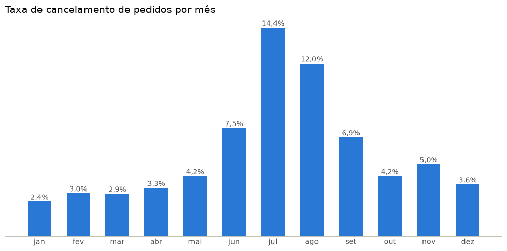
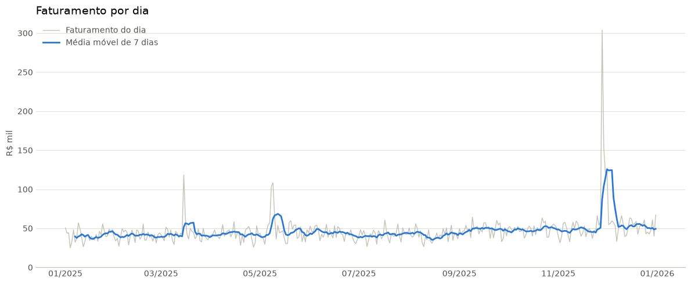

# Análise de Vendas — E-commerce

Análise exploratória de uma base de pedidos de e-commerce no formato de exportação da VTEX, com tratamento de dados, indicadores de negócio e visualizações.

> Os dados são **fictícios**, gerados por `gerar_dados_ficticios.py`. O projeto foi desenvolvido originalmente sobre uma base real, e o gerador reproduz a mesma estrutura e os mesmos problemas de qualidade.

## O que o projeto faz

- **Tratamento de dados:** remove colunas vazias, padroniza status e UFs digitados de formas diferentes e separa pedidos de pacotes.
- **Verificações de qualidade automáticas:** alertam quando a base traz um valor que o tratamento ainda não reconhece.
- **Indicadores:** faturamento bruto e líquido, ticket médio por pedido, top produtos (por faturamento e por volume), evolução diária, distribuição por estado e taxa de cancelamento.
- **Cache em Parquet:** o Excel só é relido quando é alterado.

## Destaques técnicos

- Na base, **cada linha é um item**, e o valor total se repete em todos os itens do mesmo pacote. Somar a coluna diretamente dobraria o faturamento. Os valores são somados uma vez por pacote, e os pedidos são contados de forma distinta.
- Um pedido pode ser dividido em **vários pacotes**, enviados por lojas diferentes. Por isso o ticket médio usa pedidos, e não pacotes.

## Principais resultados

| Indicador | Valor |
|---|---|
| Faturamento líquido | R$ 17,0 milhões |
| Ticket médio por pedido | R$ 469,67 |
| Taxa de cancelamento | 5,8% |

- Nos meses de pico de cancelamento (jun–ago), **60% dos cancelamentos foram por atraso na entrega**.
- A Black Friday faturou cerca de **7×** um dia típico.





Os demais gráficos (top produtos e faturamento por estado) estão no notebook e na pasta `imagens/`.

## Como executar

```bash
pip install pandas matplotlib openpyxl python-calamine pyarrow jupyter
python gerar_dados_ficticios.py
jupyter notebook analise_vendas.ipynb
```

## Arquivos

| Arquivo | Conteúdo |
|---|---|
| `analise_vendas.ipynb` | notebook com a análise completa |
| `gerar_dados_ficticios.py` | gerador da base fictícia |
| `vendas_ficticias.xlsx` | base fictícia gerada (~70 mil itens, 2025) |
| `imagens/` | gráficos exportados do notebook |
